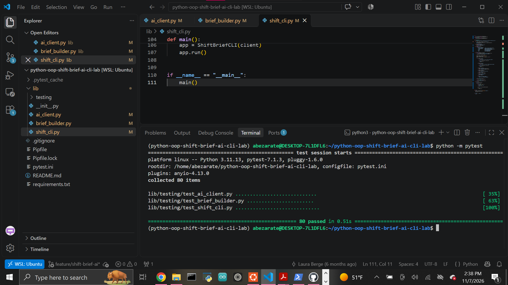

# Shift Brief AI CLI

A Python command-line application that uses a reusable AI client to create and revise structured shift handoff briefs from raw shift notes.

The project demonstrates object-oriented design, AI service integration, prompt construction, conversation history management, CLI command routing, validation, and error handling.

## Architecture

The application separates responsibilities across three components:

```text
ShiftBriefCLI
      ↓
HandoffBriefBuilder
      ↓
OllamaChatClient
      ↓
Ollama
```

Each layer has a specific responsibility.

### `OllamaChatClient`

Located in:

```text
lib/ai_client.py
```

The AI client handles generic communication with the AI service.

Responsibilities include:

- Storing the model name
- Maintaining conversation history
- Validating prompts
- Calling `ollama.chat()`
- Reading assistant responses
- Supporting dictionary-style and object-style responses
- Handling service failures
- Rolling back failed user messages
- Resetting history
- Reporting the message count
- Returning a safe copy of the transcript

The AI client remains domain-neutral and contains no shift-specific workflow logic.

### `HandoffBriefBuilder`

Located in:

```text
lib/brief_builder.py
```

The brief builder contains the shift-handoff business logic.

It:

- Builds prompts from shift notes
- Builds revision prompts
- Prevents unsupported information from being invented
- Instructs the AI to use `Unknown` when information is unavailable
- Verifies AI responses
- Formats created and revised briefs

Every usable brief must contain:

```text
Shift Summary:
Open Issues:
Action Items:
Follow-Up Questions:
Risk Notes:
```

### `ShiftBriefCLI`

Located in:

```text
lib/shift_cli.py
```

The CLI manages user interaction.

It:

- Displays command guidance
- Parses commands
- Routes requests to the brief builder
- Displays input errors
- Displays AI service errors
- Reports conversation message counts
- Resets conversation history
- Runs the interactive command loop

The CLI does not call `ollama.chat()` directly and does not directly modify the AI client's internal history.

## Commands

### Create a Brief

```text
brief <shift notes>
```

Example:

```text
brief Register 2 froze during closing and needs IT review tomorrow.
```

The application sends a structured prompt through the AI client and returns a shift handoff brief.

### Revise a Brief

```text
revise <feedback>
```

Example:

```text
revise Make the action items more specific.
```

Because the AI client maintains conversation history, the revision can build on the previous brief.

### History

```text
history
```

Example output:

```text
Conversation messages: 4.
```

Each successful AI interaction normally adds two messages:

1. User prompt
2. Assistant response

### Reset

```text
reset
```

Clears conversation history.

Example output:

```text
Conversation history reset.
```

### Help

```text
help
```

Displays the available commands.

### Exit

Either command closes the application:

```text
exit
```

```text
quit
```

Example output:

```text
Goodbye.
```

## Validation and Error Handling

Blank prompts, notes, and revision feedback are rejected before being sent to the AI service.

Examples of user-facing errors include:

```text
Input Error: Command cannot be empty.
```

```text
Input Error: Shift notes cannot be empty.
```

```text
Input Error: Revision feedback cannot be empty.
```

Unknown commands also return a readable input error.

AI service failures are returned as:

```text
Service Error: ...
```

If an AI request fails, the failed user message is removed while previous valid conversation history is preserved.

## Running the Application

This project uses Python 3.11.

Enter the Pipenv environment:

```bash
pipenv shell
```

Run the CLI as a Python module:

```bash
python -m lib.shift_cli
```

The application starts with command guidance such as:

```text
Shift Handoff Brief CLI

Available commands:
  brief <shift notes>
  revise <feedback>
  history
  reset
  help
  exit
  quit
```

## Ollama

The automated test suite does not require a running Ollama service because the AI calls are mocked.

Manual AI usage requires Ollama and the configured model.

The default model is:

```text
llama3.2
```

If necessary, install the model with:

```bash
ollama pull llama3.2
```

Then run:

```bash
python -m lib.shift_cli
```

## Setup

Clone the repository:

```bash
git clone git@github.com:Abraham-z14/python-oop-shift-brief-ai-cli-lab.git
cd python-oop-shift-brief-ai-cli-lab
```

Create the environment with Python 3.11.13:

```bash
pipenv --python ~/.pyenv/versions/3.11.13/bin/python install
```

Enter the environment:

```bash
pipenv shell
```

Verify Python:

```bash
python --version
```

Expected:

```text
Python 3.11.13
```

## Testing

Run the complete test suite:

```bash
python -m pytest
```

Current result:

```text
80 passed
```

The test suite verifies:

- AI client initialization
- Prompt validation
- Ollama request handling
- Dictionary and object response formats
- Conversation history
- Failed request rollback
- Transcript safety
- Shift-specific prompt generation
- Required brief sections
- Brief revisions
- CLI command routing
- Case-insensitive commands
- Input errors
- Service errors
- History and reset behavior
- Separation between application layers

## Completed Test Suite



## Project Structure

```text
python-oop-shift-brief-ai-cli-lab/
├── images/
│   └── tests-passing.png
├── lib/
│   ├── __init__.py
│   ├── ai_client.py
│   ├── brief_builder.py
│   ├── shift_cli.py
│   └── testing/
│       ├── conftest.py
│       ├── test_ai_client.py
│       ├── test_brief_builder.py
│       └── test_shift_cli.py
├── Pipfile
├── Pipfile.lock
├── pytest.ini
├── requirements.txt
└── README.md
```

## Key Design Principle

The project keeps each concern separate:

```text
AI client      → service communication and history
Brief builder  → shift-specific prompts and validation
CLI            → commands and user-facing output
```

This keeps the AI client reusable and makes the application easier to test, maintain, and extend.

## Author

Abraham Zarate